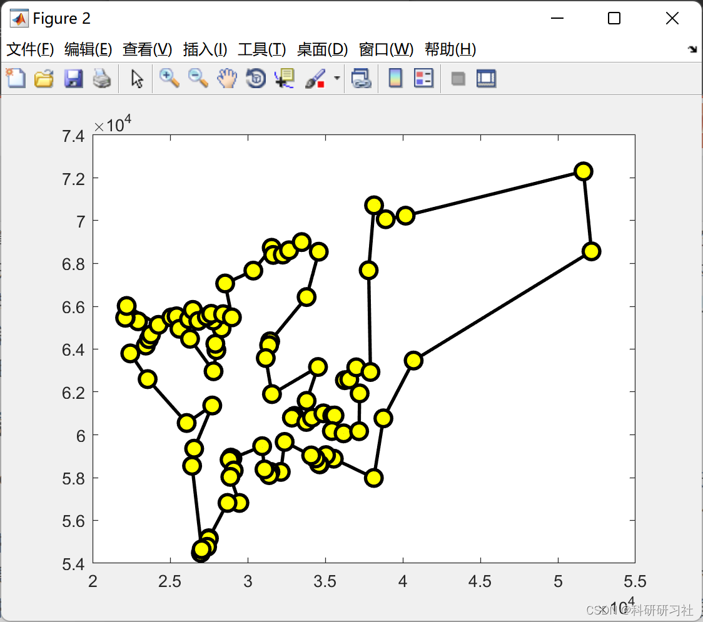
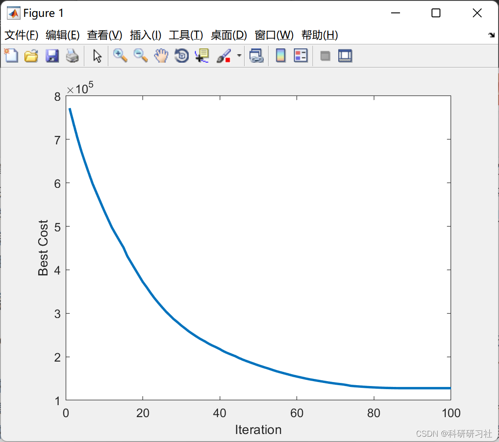
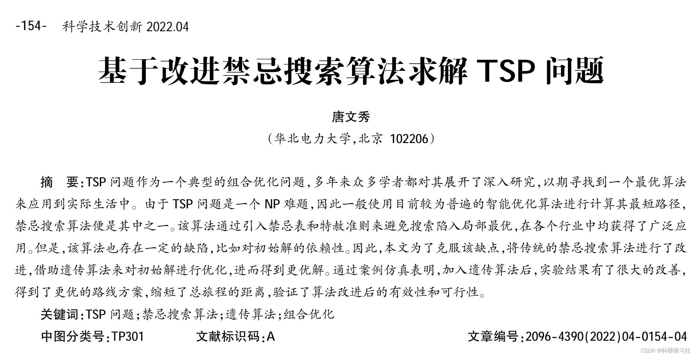

# Solution to TSP Problem Based on Improved Tabu Search Algorithm (Matlab Code)

​  
1. Overview: When the number of cities is small, theoretically, an optimal solution can be listed through exhaustive search. However, when the number of cities is large, the sum of all routes will increase exponentially, making the problem-solving process very complex and finding the optimal solution difficult. Currently, there are roughly two categories of algorithms for solving the Traveling Salesman Problem (TSP): deterministic algorithms and intelligent optimization algorithms. Deterministic algorithms typically refer to methods that can use mathematical formulas to solve a specific numerical value, which is then considered the optimal solution. Examples include linear programming, dynamic programming, and complete enumeration. However, these algorithms are only suitable for solving small-scale problems. Therefore, considering practical application scenarios, when the scale is large, people often opt for intelligent optimization algorithms, such as genetic algorithms, particle swarm optimization, simulated annealing, taboo search, immune algorithm, and artificial neural networks, etc. This paper mainly uses genetic algorithms and taboo search algorithms for hybrid problem-solving, combining the advantages of both algorithms to optimize the TSP problem and improve the quality of solutions.
The TSP problem, as a typical combinatorial optimization issue, has been the subject of in-depth research by numerous scholars over the years, with the aim of finding...
To apply an optimal algorithm to real-life scenarios. Since the TSP problem is an NP-hard problem, generally, intelligent optimization algorithms are used to calculate its shortest path.
The taboo search algorithm is one of them. This algorithm avoids local optima by introducing a taboo table and a graceful evasion criterion, which has been widely applied across various industries. However, it also has certain deficiencies, such as dependence on initial solutions. Therefore, to overcome this shortcoming, this paper improves the traditional taboo search algorithm by incorporating genetic algorithms to optimize initial solutions, thereby obtaining better solutions. Case simulations show that after incorporating the genetic algorithm, the experimental results have significantly improved, resulting in better route plans, reducing the total distance traveled, and verifying the effectiveness and feasibility of the algorithm improvement.
2. Improved Tabu Search Algorithm
In 1986, Professor Fred Glover proposed the Tabu Search algorithm (TS, abbreviated as TS algorithm), highlighting its strong local search capability and ability to avoid getting trapped in local optima, thereby finding the global optimal solution, making it a global iterative optimization algorithm. Over the years, this algorithm has also been favored by many scholars due to its flexible memory characteristics and heuristic rules.
The term "tabu" refers to prohibiting repetitive operations, similar to human thinking patterns. If a region has been searched before, it can be recorded in the tabu list during the next search to avoid repeated and inefficient searches. However, it is not completely isolated; for better solutions, they can also be released through the heuristic rule to improve the quality of the solution and avoid missing out.
3. Run Results
Edit
4. Matlab Code Implementation
This article only showcases part of the code, with all codes available at: Solving TSP Problem Using Improved Tabu Search Algorithm (Matlab Code Implementation)
function model = LoadData()\ntemp =[\n1 36266.6667 62550.0000\n2 34600.0000 58633.3333\n3 51650.0000 72300.0000\n4 37800.0000 67683.3333\n5 35428.0556 60174.1667\n6 34583.3333 68550.0000\n7 27383.3333 54766.6667\n8 34533.3333 63166.6667\n9 23766.6667 64683.3333\n10 32383.3333 59666.6667\n11 32383.3333 59666.6667\n12 25416.6667 65533.3333\n13 31383.3333 64183.3333\n14 37916.6667 62933.3333\n15 37183.3333 60166.6667\n16 35600.0000 60900.0000\n17 33783.3333 60600.0000\n18 35454.1667 60891.3889\n19 31650.0000 68400.0000\n20 28833.3333 58833.3333\n21 26283.3333 64483.3333\n22 34642.5000 58618.0556\n23 34150.0000 60800.0000\n24 33800.0000 61583.3333\n25 32666.6667 68616.6667\n26 27033.3333 54650.0000\n27 32266.6667 68416.6667\n28 35550.0000 58883.3333\n29 25083.3333 65483.3333\n30 28550.0000 67066.6667\n31 23550.0000 62600.0000\n32 36550.0000 62583.3333\n33 38750.0000 60766.6667\n34 27716.6667 61366.6667\n35 28316.6667 64966.6667\n36 31550.0000 68733.3333\n37 37216.6667 61933.3333\n38 37216.6667 61933.3333\n39 35550.0000 58883.3333\n40 31566.6667 61900.0000\n41 31566.6667 61900.0000\n42 34374.7222 58895.2778\n43 33016.6667 60883.3333\n44 34883.3333 61000.0000\n45 34092.2222 59035.0000\n46 26216.6667 65400.0000\n47 24250.0000 65133.3333\n48 35050.0000 59050.0000\n49 33483.3333 69000.0000\n50 26066.6667 60550.0000\n51 27783.3333 65333.3333\n52 26550.0000 59350.0000\n53 38900.0000 70066.6667\n54 40700.0000 63466.6667\n55 27916.6667 64250.0000\n56 33800.0000 66433.3333\n57 52166.6667 68566.6667\n58 40183.3333 70233.3333\n59 37000.0000 63150.0000\n60 23633.3333 64466.6667\n61 28700.0000 56816.6667\n62 31383.3333 58116.6667\n63 28883.3333 58033.3333\n64 38150.0000 70716.6667\n65 27366.6667 65516.6667\n66 27800.0000 62966.6667\n67 23433.3333 64166.6667\n68 38133.3333 57983.3333\n69 22200.0000 66016.6667\n70 29100.0000 58333.3333\n71 31450.0000 64366.6667\n72 31450.0000 64366.6667\n73 28416.6667 65633.3333\n74 30366.6667 67666.6667\n75 30933.3333 59466.6667\n76 31466.6667 58266.6667\n77 36183.3333 60066.6667\n78 27500.0000 55166.6667\n79 27483.3333 55133.3333\n80 26983.3333 54483.3333\n81 28983.3333 65483.3333\n82 26816.6667 65316.6667\n83 31166.6667 63583.3333\n84 27800.0000 62966.6667\n85 32850.0000 60800.0000\n86 22100.0000 65466.6667\n87 22133.3333 65466.6667\n88 29016.6667 58900.0000\n89 32133.3333 58266.6667\n90 28916.6667 58933.3333\n91 25600.0000 64950.0000\n92 29016.6667 58900.0000\n93 26416.6667 58550.0000\n94 26466.6667 65833.3333\n95 27983.3333 63950.0000\n96 31083.3333 58383.3333\n97 22433.3333 63800.0000\n98 22933.3333 65300.0000\n99 29466.6667 56816.6667\n100 27650.0000 65650.0000\n    ];\n\npos = [temp(:,2)'; temp(:,3)']';\nD = pdist2(pos,pos);\n\nmodel.X = temp(:,2)';\nmodel.Y = temp(:,3)';\nmodel.N = numel(temp(:,2)');\nmodel.D = D;\nmodel.Xmin = min(model.X);\nmodel.Xmax = max(model.X);\nmodel.Ymin = min(model.Y);\nmodel.Ymax = max(model.Y);\n\nend\n  
5. References Editor

## Images

<!-- PAYMENT_BLOCK -->

## Get this dataset

- Payment link (Stripe): [Buy now](https://buy.stripe.com/3cs8yP7sY87d0vu9AB)
- Payment QR code: 

<!-- /PAYMENT_BLOCK -->
